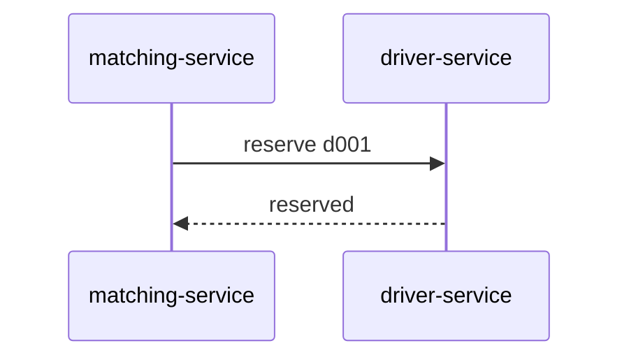

# Documentation with Mermaid

## Rule

All documentation is `Markdown`. Architecture and design visuals are `Mermaid` diagrams in the
Markdown (not ASCII art, not image files). Follow the `markdown-lint` skill as well.

## When to use which diagram

| Need                          | Mermaid diagram   |
| ----------------------------- | ----------------- |
| Services and how they connect | `flowchart`       |
| Requests and webhooks         | `sequenceDiagram` |
| Trip and driver states        | `stateDiagram-v2` |
| Tables                        | `erDiagram`       |

## Conventions

- One diagram per concept; readable over exhaustive.
- Label edges with the message (`reserve d001`, `TripMatched`).
- Pair every diagram with a sentence or two of context.

## Syntax traps (these break rendering)

- No `;` in sequence-diagram message text: it ends the statement. Write `one TX: trip + outbox`.
- No `#` in message text; write "number".
- `Brackets and braces in flowchart labels` need quotes: `A["stock {sku: 1}"]`.
- Check before committing: parse every block with the `mermaid` npm package under jsdom.

## Example

