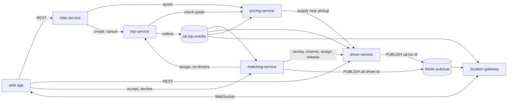
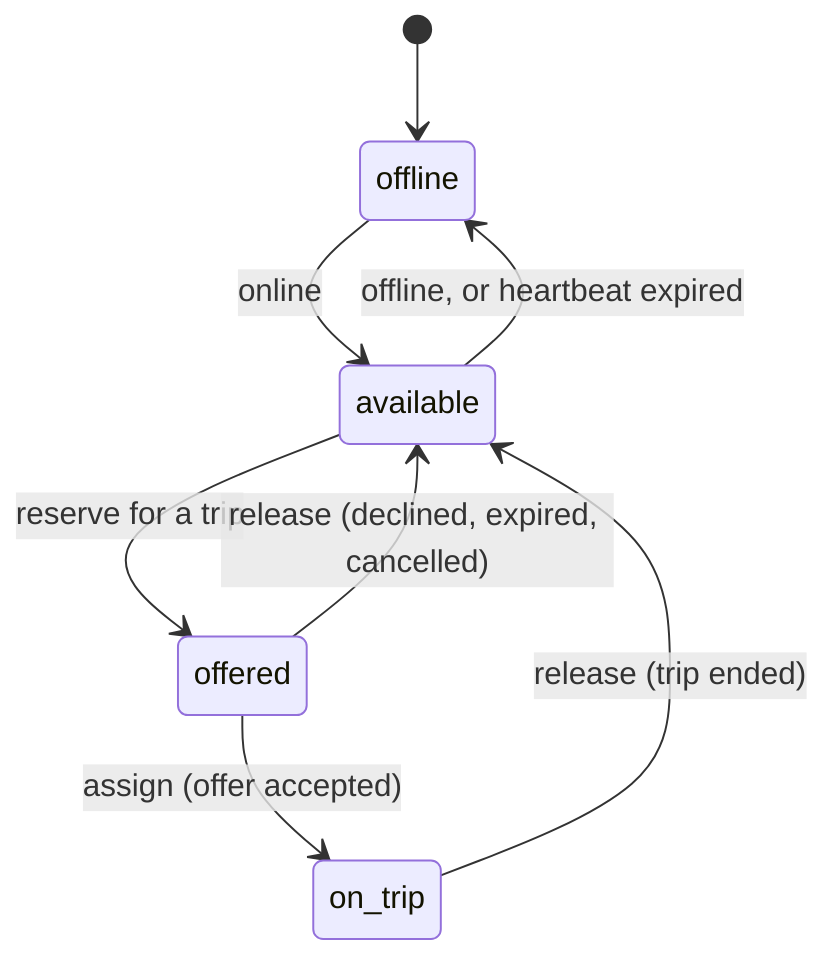
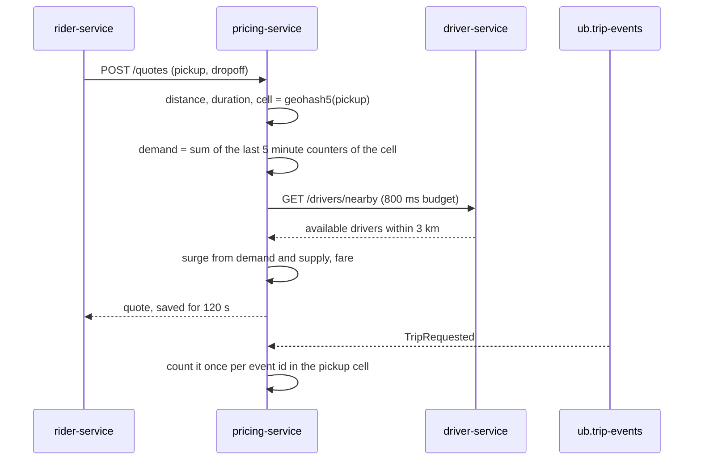
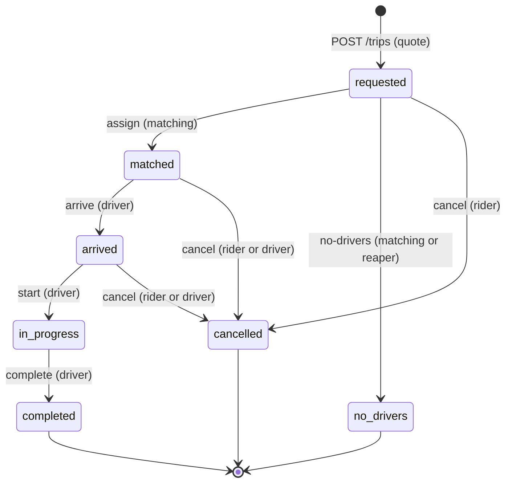
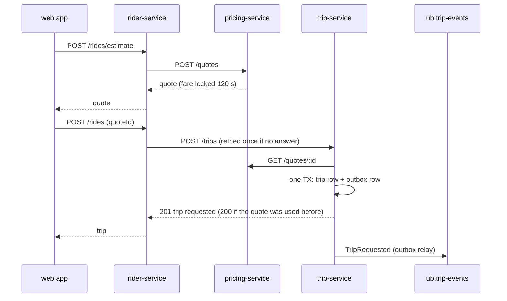
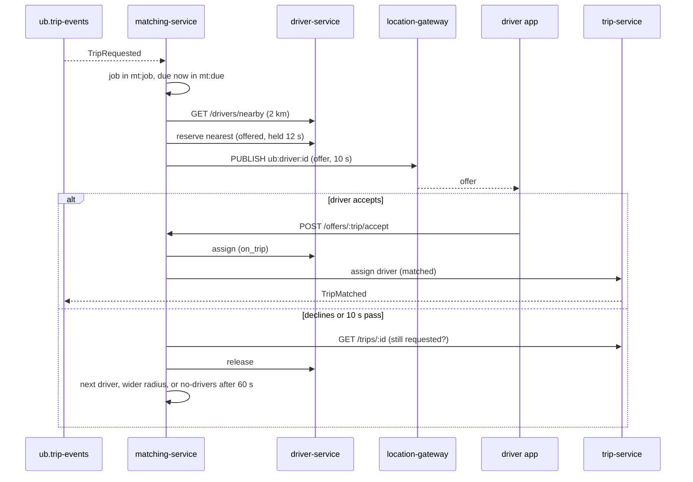

# Architecture

## Services and data

Each service owns its data: Postgres databases `riders`, `drivers` and `trips`, and Redis key prefixes `drv:`, `mt:` and `prc:`.

## driver-service

Driver profiles are in Postgres. Location and availability change every few seconds and live in Redis (ADR-005):

| Key                 | Holds                                                   |
| ------------------- | ------------------------------------------------------- |
| `drv:geo`           | Every online driver (GEO set), read by the map          |
| `drv:geo:available` | Drivers a matcher may offer to, read by `GEOSEARCH`     |
| `drv:state:<id>`    | Hash: status, trip id, position, last update, offer end |
| `drv:alive:<id>`    | Heartbeat with a TTL, refreshed by each location update |

Every arrow is one Lua script, so the status, the heartbeat and both GEO sets change together (ADR-007).

| Endpoint                                     | Caller            | Does                                            |
| -------------------------------------------- | ----------------- | ----------------------------------------------- |
| `PUT /drivers/:id/online`                    | driver            | Available at a position                         |
| `PUT /drivers/:id/location`                  | driver            | New position, heartbeat, publish to the gateway |
| `PUT /drivers/:id/offline`                   | driver            | 409 `DRIVER_BUSY` while offered or on a trip    |
| `GET /drivers/nearby?lat&lng&radiusKm&limit` | matching, pricing | Available drivers, nearest first                |
| `GET /drivers/online`                        | web map           | Every online driver with status                 |
| `POST /internal/drivers/:id/reserve`         | matching          | `available` → `offered` for one trip            |
| `POST /internal/drivers/:id/assign`          | matching          | `offered` → `on_trip` for that trip             |
| `POST /internal/drivers/:id/release`         | matching          | Back to `available` if held for that trip       |
| `GET /admin/stats`                           | lab               | Online, available, location writes per second   |

driver-service also consumes `ub.trip-events` (group `driver-service`): `TripCompleted`, `TripCancelled` and `TripNoDrivers` release the driver of that trip.

## pricing-service

| Key                          | Holds                                        |
| ---------------------------- | -------------------------------------------- |
| `prc:quote:<id>`             | Quote JSON, TTL 120 s (the price lock)       |
| `prc:demand:<cell>:<minute>` | Requests in that cell and minute, TTL 61 min |
| `prc:cells`                  | Sorted set: cell by last request time        |
| `prc:seen:<eventId>`         | Dedupe marker for consumed events, TTL 24 h  |

Fare in minor units: `max(8000, 5000 + 1200 x km + 200 x min) x surge`, rounded to whole currency units. Surge = `1 + (demand / supply - 1) x 0.5`, from 1.0 to 3.0; supply unknown means 1.0.

## trip-service

Every arrow is `UPDATE ... WHERE id AND version` plus an outbox row in one transaction (ADR-013). The event names are `TripRequested`, `TripMatched`, `DriverArrived`, `TripStarted`, `TripCompleted`, `TripCancelled` and `TripNoDrivers`, keyed by trip id on `ub.trip-events`.

| Index                         | Guards                                             |
| ----------------------------- | -------------------------------------------------- |
| `trips_quote_id_key`          | One trip per quote (idempotent request, ADR-012)   |
| `trips_one_active_per_rider`  | A rider has at most one requested or ongoing trip  |
| `trips_one_active_per_driver` | A driver is on at most one matched or ongoing trip |
| `outbox_pending_idx`          | The relay scans only unsent rows                   |

## matching-service

| Key                   | Holds                                                  |
| --------------------- | ------------------------------------------------------ |
| `mt:job:<tripId>`     | Pickup, dropoff, fare, radius, declined drivers, offer |
| `mt:due`              | Trip ids by the next time their job needs a step       |
| `mt:offer:<driverId>` | The trip a driver is offered, for the polling fallback |
| `mt:lock:<tripId>`    | Lock token so one instance handles a trip at a time    |

| Endpoint                          | Caller | Does                                        |
| --------------------------------- | ------ | ------------------------------------------- |
| `GET /offers/current`             | driver | The open offer for the caller, or null      |
| `POST /offers/:tripId/accept`     | driver | Matched; 409 if expired, gone or not theirs |
| `POST /offers/:tripId/decline`    | driver | Next driver right away                      |
| `GET /admin/jobs`, `/admin/stats` | lab    | Open jobs with due times; counters          |
